# CloudMart Disaster Recovery Plan

**Version:** 1.0  
**Date:** June 2026  
**Environment:** Production (`cloudmart-prod`)  
**Cloud Provider:** AWS (`us-east-1`)  
**Author:** IS 4630 Group — CloudMart

---

## 1. Overview

This document defines the Disaster Recovery (DR) strategy for the CloudMart e-commerce platform. It establishes Recovery Time Objectives (RTO) and Recovery Point Objectives (RPO), documents backup mechanisms, and provides step-by-step recovery procedures for each failure scenario.

CloudMart is a microservices platform running on Amazon EKS with five services (product-service, order-service, user-service, notification-service, frontend) backed by Amazon RDS PostgreSQL, Amazon DynamoDB, and Amazon SQS.

---

## 2. RTO and RPO Targets

| Tier | Component | RTO | RPO | Justification |
|------|-----------|-----|-----|---------------|
| **Critical** | `user-service` + RDS PostgreSQL | 1 Hour | 1 Hour | User authentication data. Loss of user accounts directly impacts platform access and revenue. |
| **Critical** | `product-service` + DynamoDB | 30 Mins | Near-Zero | Product catalogue is read-heavy. DynamoDB features multi-AZ replication by default; data loss is unacceptable as it stalls all shopping journeys. |
| **High** | `order-service` + SQS | 1 Hour | 15 Mins | In-flight orders and event queues. Messages not processed within the visibility window could result in lost order transactions. |
| **Medium** | `notification-service` | 2 Hours | 1 Hour | Email notifications are asynchronous and non-blocking; delayed delivery is acceptable. |
| **Low** | `frontend` | 30 Mins | N/A | Stateless service (served by Nginx). No data store; recovery involves redeploying container images from Amazon ECR. |

### Business Justification
- **RTO (Recovery Time Objective)**: CloudMart is a retail platform. A 4-hour global RTO is targeted for complete environment rebuilding, while critical data paths (users/orders) target a 1-hour RTO. This limits revenue loss and customer friction during a severe outage.
- **RPO (Recovery Point Objective)**: An RPO of 1 hour for transaction databases ensures minimal transactional loss. RDS continuous transaction log shipping and DynamoDB PITR provide restoration capabilities down to the second.

---

## 3. Backup and Recovery Strategies

### 3.1 Relational Database (RDS PostgreSQL)
- **Backup Type**: Automated daily snapshots + continuous Write-Ahead Log (WAL) archiving to Amazon S3.
- **Retention**: 7 days (defined in Terraform under `backup_retention_period = 7`).
- **Encryption**: Encrypted at rest using AWS KMS (`aws_kms_key` managed via IaC) and enforced SSL in transit.

#### Point-in-Time Recovery (PITR) Procedure
1. Identify the target timestamp prior to the corruption/failure event.
2. Initiate a database restore using the AWS Console or the AWS CLI:
   ```bash
   aws rds restore-db-instance-to-point-in-time \
     --source-db-instance-identifier cloudmart-prod-postgres \
     --target-db-instance-identifier cloudmart-prod-postgres-recovered \
     --restore-time 2026-06-07T01:00:00Z \
     --db-instance-class db.t3.micro \
     --region us-east-1
   ```
3. Monitor status until it becomes `Available`.
4. Update the Kubernetes ConfigMap (`k8s/configmap.yaml` → `DB_HOST`) with the new RDS endpoint.
5. Perform a rolling restart of the application pods:
   ```bash
   kubectl rollout restart deployment/user-service -n cloudmart-prod
   ```

### 3.2 NoSQL Database (Amazon DynamoDB)
- **Backup Type**: Point-in-Time Recovery (PITR) enabled. Continuous backups are archived automatically.
- **Retention**: 35 days (automatic AWS window).

#### Recovery Procedure
1. Restore the DynamoDB table to a new table name:
   ```bash
   aws dynamodb restore-table-to-point-in-time \
     --source-table-name cloudmart-products \
     --target-table-name cloudmart-products-recovered \
     --use-latest-restorable-time
   ```
2. Update the environment variables in the EKS Deployment config or ConfigMap with the recovered table name.
3. Restart the `product-service` deployment.

### 3.3 Kubernetes Manifest Backup (GitOps & State Recovery)
- **Git Repository**: The absolute source of truth for all Kubernetes configuration. All service manifests (deployments, services, HPA, ingress, network policies) are stored in the `/k8s` directory.
- **State Export (DR Validation)**: To export active runtime states for verification, the following command runs in the pipeline/scheduler:
   ```bash
   kubectl get all,configmaps,secrets,networkpolicies,ingresses,hpa,pdb -n cloudmart-prod -o yaml > docs/k8s-backup/live-configuration.yaml
   ```
- **Velero Integration (Optional/Distinction)**: For full-state backup (including potential Persistent Volumes), Velero is configured to back up to an S3 bucket:
   ```bash
   velero backup create cloudmart-scheduled-backup --include-namespaces cloudmart-prod
   ```

---

## 4. High Availability & Failover Procedures

### 4.1 Multi-Zone Database Deployment
To satisfy Section 3.9 [R], Amazon RDS PostgreSQL is configured in a Multi-AZ structure.
- **Mechanism**: AWS maintains a synchronous standby instance in a secondary Availability Zone.
- **Failover Behavior**: In the event of a primary AZ outage, RDS automatically fails over to the standby instance in under 120 seconds. The DNS CNAME endpoint remains unchanged, requiring no code modification or manual intervention.
- **Manual Failover Verification**:
   ```bash
   aws rds reboot-db-instance \
     --db-instance-identifier cloudmart-prod-postgres \
     --force-failover \
     --region us-east-1
   ```

### 4.2 DNS Failover to Static Error Page (Section 3.9 [D])
If the primary Application Load Balancer (ALB) fails health checks:
1. **Route 53 Health Check**: Monitors the ALB endpoint.
2. **S3 Static Website Hosting**: Holds a static maintenance page (`index.html`) in a bucket named `cloudmart-maintenance-page`.
3. **Route 53 Failover Routing Policy**:
   - **Primary Record**: Points to the ALB.
   - **Secondary Record**: Points to the S3 bucket website endpoint.
4. When Route 53 detects the ALB is unhealthy, it dynamically shifts DNS routing to S3, rendering the maintenance page to users.

---

## 5. Disaster Recovery Playbook

In the event of a catastrophic regional failure or total cluster destruction, the following sequence restores operations within the 4-hour RTO:

```mermaid
gantt
    title Disaster Recovery Timeline (Target: 80 Mins)
    dateFormat  m
    axisFormat %M
    section Phases
    Incident Detection & Triage    :a1, 0, 5m
    IaC Infrastructure Rebuild    :a2, after a1, 30m
    Database Point-in-Time Restore :a3, after a2, 15m
    Kubernetes Manifest Deployment :a4, after a3, 15m
    Smoke Testing & DNS Promotion :a5, after a4, 15m
```



| Step | Phase | Action | Responsible Role | Target Duration |
|------|-------|--------|------------------|-----------------|
| 1 | **Triage** | Confirm outage, verify data integrity, declare DR state. | Lead Cloud Engineer | 5 Mins |
| 2 | **IaC Rebuild** | Execute `terraform apply -auto-approve` to rebuild EKS, subnets, and security groups. | DevOps Engineer | 30 Mins |
| 3 | **Data Recovery** | Initiate RDS PITR and DynamoDB restore to recovered tables. | Database Administrator | 15 Mins |
| 4 | **Deployment** | Apply Kubernetes manifests from Git repository (`kubectl apply -f k8s/`). | DevOps Engineer | 15 Mins |
| 5 | **Validation** | Verify pod startup, run automated HTTP smoke tests, and promote DNS routing. | QA / Lead Engineer | 15 Mins |